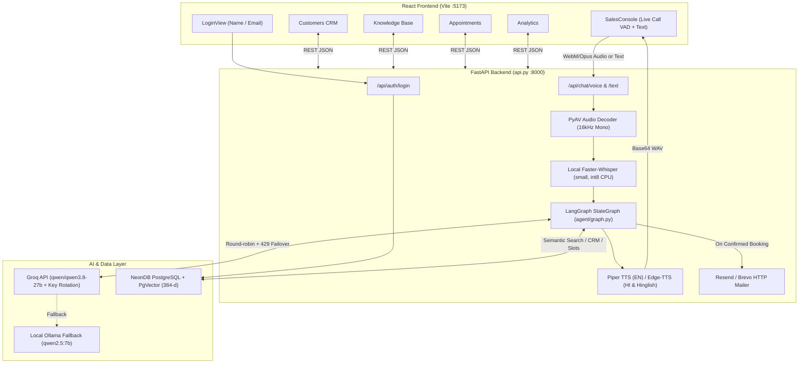
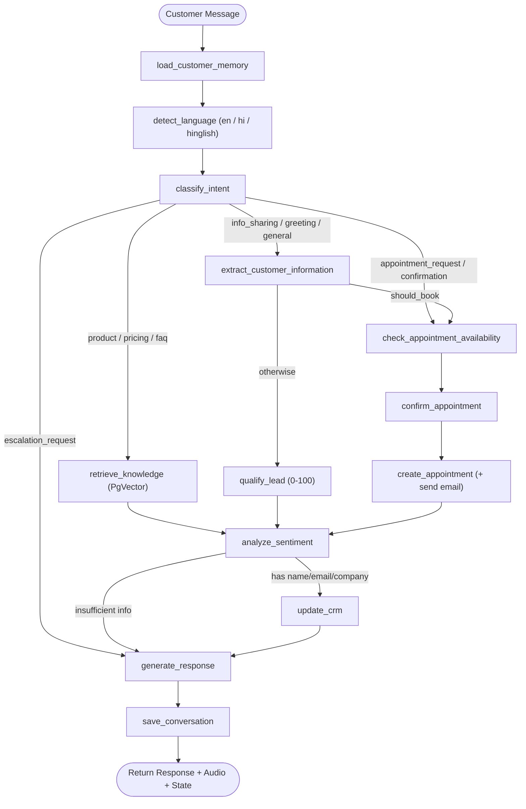

# 🤖 TechVex Autonomous AI Sales Voice Agent

A full-stack, real-time multilingual **Autonomous AI Sales Voice Agent** built with a **FastAPI** backend, a **React (Vite + Tailwind CSS)** frontend, **LangGraph** orchestration, **Groq (`qwen/qwen3.8-27b` with multi-key rotation & local Ollama fallback)**, **Faster-Whisper (local CPU STT)**, **Piper TTS + Edge-TTS (multilingual TTS)**, **NeonDB PostgreSQL + PgVector (RAG)**, and **Resend / Brevo** email delivery.

---

## 📋 Table of Contents
1. [System Architecture](#system-architecture)
2. [LangGraph Agent Workflow](#langgraph-agent-workflow)
3. [Voice & Live Call Pipeline](#voice--live-call-pipeline)
4. [Database Schema (NeonDB + PgVector)](#database-schema-neondb--pgvector)
5. [RAG Knowledge Pipeline](#rag-knowledge-pipeline)
6. [FastAPI REST API Reference](#fastapi-rest-api-reference)
7. [Project Structure](#project-structure)
8. [Installation & Setup](#installation--setup)
9. [Running Both Servers](#running-both-servers)
10. [Testing](#testing)
11. [Security & Scalability](#security--scalability)

---

## 🏗 System Architecture

The application runs as a **dual-server architecture**:
1. **Frontend Server (`frontend/`, port `5173`)**: React 19 + Vite + Tailwind CSS v4 + Lucide Icons, proxying `/api/*` to FastAPI.
2. **Backend Server (`api.py`, port `8000`)**: FastAPI + Uvicorn hosting the LangGraph sales agent, PyAV audio decoder, Faster-Whisper STT, Piper/Edge TTS, PgVector RAG, CRM/Calendar services, and 3rd-party email delivery.



### Key Architectural Components
- **Customer Login & Memory ([api.py](file:///c:/Sathvik-py/Competitions/FORTIVEX-AI/api.py), [memory.py](file:///c:/Sathvik-py/Competitions/FORTIVEX-AI/intelligence/memory.py))**: Customers sign in with Name, Email, or both (`POST /api/auth/login`). Returning customers are loaded from NeonDB; new customers are created immediately. The console greets them by name and pre-populates `customer_id`, `name`, and `email` in agent memory.
- **Multi-Key Groq LLM + Local Ollama Fallback ([groq_keys.py](file:///c:/Sathvik-py/Competitions/FORTIVEX-AI/services/groq_keys.py), [tools.py](file:///c:/Sathvik-py/Competitions/FORTIVEX-AI/agent/tools.py))**: Round-robins across `GROQ_API_KEYS` / `GROQ_API_KEY_2..5`, cools down rate-limited keys (`429`) for 60s with automatic retry on the next key, and falls back to local Ollama if Groq is unreachable.
- **Deterministic Lead Qualification ([qualification.py](file:///c:/Sathvik-py/Competitions/FORTIVEX-AI/intelligence/qualification.py))**: LLM extracts structured entities; Python deterministically computes scores (0–100 across Budget 25, Timeline 20, Authority 20, Requirements 20, Engagement 15) into `HOT` (≥80), `WARM` (50–79), or `COLD` (<50).
- **Hybrid Sentiment & Escalation ([sentiment.py](file:///c:/Sathvik-py/Competitions/FORTIVEX-AI/intelligence/sentiment.py))**: Combines rule-based frustration/objection/urgency detection with LLM sentiment analysis.
- **Transactional Appointment Booking + Email ([calendar.py](file:///c:/Sathvik-py/Competitions/FORTIVEX-AI/services/calendar.py), [mailer.py](file:///c:/Sathvik-py/Competitions/FORTIVEX-AI/services/mailer.py))**: Locks available slots using `SELECT ... FOR UPDATE NOWAIT` + `UNIQUE (appointment_date, appointment_time)` and sends HTML + plain-text confirmation emails via **Resend** (`RESEND_API_KEY`) or **Brevo** (`BREVO_API_KEY`).

---

## 🔀 LangGraph Agent Workflow



---

## 🎙 Voice & Live Call Pipeline

1. **Hands-Free Live Call ([SalesConsole.jsx](file:///c:/Sathvik-py/Competitions/FORTIVEX-AI/frontend/src/components/SalesConsole.jsx))**:
   - Browser `getUserMedia` (echo cancellation + noise suppression) feeds a Web Audio API `AnalyserNode`.
   - When RMS exceeds the speech threshold, `MediaRecorder` captures the utterance; after `1.2s` of silence, it automatically posts the audio to `POST /api/chat/voice`.
   - VAD pauses while the agent thinks and speaks (with an **Interrupt** button to stop playback and resume listening immediately).
2. **Backend Audio Processing ([api.py](file:///c:/Sathvik-py/Competitions/FORTIVEX-AI/api.py), [stt.py](file:///c:/Sathvik-py/Competitions/FORTIVEX-AI/voice/stt.py), [tts.py](file:///c:/Sathvik-py/Competitions/FORTIVEX-AI/voice/tts.py))**:
   - `PyAV` decodes browser WebM/Opus/WAV bytes in-memory to 16 kHz mono `float32`.
   - Local **Faster-Whisper** (`small`, CPU `int8`) transcribes and detects language.
   - **Piper TTS** (`en_US-lessac-medium`) synthesizes English speech locally; **Edge-TTS** (`hi-IN-SwaraNeural` / `en-IN-NeerjaNeural`) synthesizes Hindi/Hinglish speech.
   - Response WAV bytes are returned as base64 and played via a detached browser `Audio` instance.

---

## 🗄 Database Schema (NeonDB + PgVector)

- **`customers`**: `id (UUID)`, `name`, `email (UNIQUE)`, `phone`, `company`, `company_size`, `budget`, `budget_currency`, `requirements`, `lead_score`, `lead_category`, `sentiment`, `preferred_language`, `last_interaction`, `follow_up_status`, `decision_maker`, `purchase_timeline`, `objections`, `buying_intent`.
- **`conversations`** & **`messages`**: Session metadata, detected language, final score/sentiment, and per-turn transcript history.
- **`available_slots`** & **`appointments`**: Weekday slots seeded 30 days ahead; bookings enforced with `CONSTRAINT no_overlap UNIQUE (appointment_date, appointment_time)`.
- **`documents`** & **`document_chunks`**: SHA-256 deduplicated documents + `embedding vector(384)` chunks in PgVector.
- **`call_summaries`**: Structured post-call summaries (`requirements`, `budget`, `objections`, `recommended_action`, `full_summary`).

---

## 📚 RAG Knowledge Pipeline

1. **Extraction** ([ingest.py](file:///c:/Sathvik-py/Competitions/FORTIVEX-AI/rag/ingest.py)): `pymupdf` (with `pypdf` fallback) for PDF, `python-docx` for DOCX, UTF-8 for TXT/MD.
2. **Chunking & Embeddings** ([retriever.py](file:///c:/Sathvik-py/Competitions/FORTIVEX-AI/rag/retriever.py)): Sentence-aware chunking (`CHUNK_SIZE=512`, `CHUNK_OVERLAP=50`) embedded with `paraphrase-multilingual-MiniLM-L12-v2` (384-d).
3. **Retrieval**: Cosine distance (`<=>`) in NeonDB PgVector with `min_similarity=0.3` and `TOP_K_RESULTS=5`. Six sample TechVex Solutions documents in `rag/documents/` are auto-ingested on first startup.

---

## 🔌 FastAPI REST API Reference

| Method | Endpoint | Purpose |
|---|---|---|
| `GET` | `/api/health` | Health status for DB, LLM, STT, TTS, RAG |
| `POST` | `/api/auth/login` | Sign in / register customer by name and/or email |
| `POST` | `/api/chat/text` | Process text turn via LangGraph + optional TTS WAV |
| `POST` | `/api/chat/voice` | Decode audio → Faster-Whisper STT → LangGraph → TTS WAV |
| `POST` | `/api/chat/summarize` | Generate & persist post-call summary |
| `GET` | `/api/customers` | Search & filter CRM records |
| `GET` | `/api/documents` | List indexed knowledge base documents |
| `POST` | `/api/documents/upload` | Upload & ingest PDF/TXT/DOCX/MD into PgVector |
| `POST` | `/api/documents/query` | Semantic similarity search against PgVector |
| `GET` | `/api/appointments` | List scheduled/cancelled appointments |
| `GET` | `/api/appointments/slots` | List upcoming available slots |
| `POST` | `/api/appointments/{id}/cancel` | Cancel appointment & free slot |
| `GET` | `/api/analytics` | KPIs, distributions, summaries & follow-up queue |

---

## 📁 Project Structure

```text
FORTIVEX-AI/
├── api.py                      # FastAPI backend server (:8000)
├── requirements.txt            # Python dependencies
├── .env.example                # Environment template
├── .gitignore                  # Ignores __pycache__, .env, node_modules, dist, models
├── frontend/                   # React + Vite + Tailwind CSS UI (:5173)
│   ├── package.json
│   ├── vite.config.js          # Proxies /api -> http://127.0.0.1:8000
│   └── src/
│       ├── App.jsx             # Sidebar navigation, health indicator & auth gate
│       ├── api.js              # REST API client
│       └── components/
│           ├── LoginView.jsx
│           ├── SalesConsole.jsx
│           ├── CustomersView.jsx
│           ├── KnowledgeBaseView.jsx
│           ├── AppointmentsView.jsx
│           └── AnalyticsView.jsx
├── agent/                      # LangGraph StateGraph, state, prompts, LLM tools
├── voice/                      # Faster-Whisper STT, Piper/Edge TTS, language, VAD
├── intelligence/               # Qualification, sentiment, memory, summarizer, insights
├── rag/                        # Ingestion, PgVector retriever & sample documents
├── services/                   # CRM, transactional calendar, Resend/Brevo mailer, Groq key pool
├── database/                   # NeonDB connection pool & DDL schema
├── dashboard/                  # Plotly chart helpers
└── tests/                      # Unit & end-to-end tests
```

---

## 🛠 Installation & Setup

### 1. Python Dependencies
```powershell
pip install -r requirements.txt
pip install edge-tts
```

### 2. Frontend Dependencies
```powershell
cd frontend
npm install
cd ..
```

### 3. Configure `.env`
Copy `.env.example` to `.env` and set:
- `DATABASE_URL` (NeonDB PostgreSQL with `pgvector`)
- `GROQ_API_KEY` (and optional `GROQ_API_KEY_2` / `GROQ_API_KEYS`) for fast LLM inference, or `LLM_PROVIDER=ollama` for local `qwen2.5:7b`
- `RESEND_API_KEY` + `EMAIL_FROM=onboarding@resend.dev` (or `BREVO_API_KEY`) for appointment confirmation emails

---

## ▶ Running Both Servers

**Terminal 1 — FastAPI Backend (`:8000`):**
```powershell
python api.py
```

**Terminal 2 — React Frontend (`:5173`):**
```powershell
cd frontend
npm run dev
```
*(Optional if using local LLM fallback instead of Groq: run `ollama serve` in another terminal.)*

Open `http://localhost:5173` in your browser.

---

## 🧪 Testing

```powershell
python -m pytest tests/test_all.py -v
```
To verify the React production bundle:
```powershell
cd frontend
npm run build
```

---

## 🔒 Security & Scalability

- **Async Backend**: All FastAPI endpoints run as `async def` coroutines offloading CPU/DB/LLM/audio work via `asyncio.to_thread` and running independent checks/queries concurrently via `asyncio.gather` so the event loop stays non-blocking.
- **Security**: Secrets live in `.env` (excluded via `.gitignore`); all SQL queries are parameterized; microphone audio is processed in-memory and not persisted to disk.
- **Scalability**: Production scaling separates stateless FastAPI/LangGraph workers, LiveKit WebRTC SFU, Redis session state, and managed PostgreSQL + PgVector.
